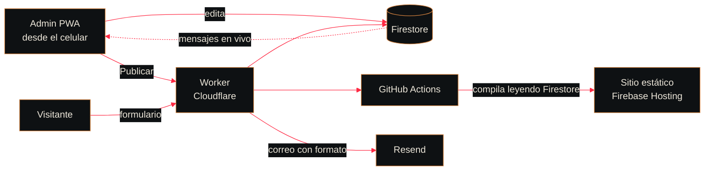

 

<b>MEDELLÍN, COLOMBIA</b> &nbsp;·&nbsp; DISPONIBLE PARA PROYECTOS Y EQUIPOS DE PRODUCTO

 

## <code>01</code> Quién soy

<table>
<tr>
<td width="62%" valign="top">

Diseño y construyo **sistemas de software**, desde la arquitectura hasta el producto en manos de usuarios.

Mi base empezó abajo, en **algoritmos y electrónica digital** con prototipos en Arduino. Hoy trabajo arriba: servicios, **integraciones de pagos y mensajería**, e **IA aplicada** con agentes y RAG.

Estudio Ingeniería Informática en el Politécnico Jaime Isaza Cadavid. He trabajado en equipos de producto (ZETA, DevsCode) y en el semillero LaboratorioZ.

Este repositorio es mi portafolio y, a la vez, una muestra de cómo trabajo.

</td>
<td width="38%" valign="top">

**Enfoque**

- Arquitectura de software
- APIs e integraciones
- IA aplicada: agentes, RAG
- Producto de punta a punta

**Ahora**

- Pagos y mensajería en producción
- Agentes de código en el flujo diario

</td>
</tr>
</table>

## <code>02</code> Cómo trabajo

> **Entiendo el problema, trazo los límites y elijo la arquitectura más simple que aguante lo que viene.**

## <code>03</code> Proyectos destacados

<table>
<tr>
<td width="50%" valign="top">

### [Excentrix](https://daniel-dev-portafolio.web.app/proyectos/excentrix)
PRODUCTO COMERCIAL · 2026

Catálogo digital de perfumería con decants y compra guiada por WhatsApp.

[Caso →](https://daniel-dev-portafolio.web.app/proyectos/excentrix) &nbsp;·&nbsp; [Sitio ↗](https://excentrix.web.app/)

</td>
<td width="50%" valign="top">

### [Dayed Inmobiliaria](https://daniel-dev-portafolio.web.app/proyectos/dayed-inmobiliaria)
TRABAJO COMERCIAL · DEVSCODE

Descubrimiento de inmuebles con filtros, mapa, favoritos y contacto directo.

[Caso →](https://daniel-dev-portafolio.web.app/proyectos/dayed-inmobiliaria)

</td>
</tr>
<tr>
<td width="50%" valign="top">

### [LiquiLegal](https://daniel-dev-portafolio.web.app/proyectos/liquilegal)
PROYECTO COMERCIAL · ZETA

Pasarela de pagos y recuperación documental con un microservicio RAG.

[Caso →](https://daniel-dev-portafolio.web.app/proyectos/liquilegal)

</td>
<td width="50%" valign="top">

### [EasyLang Compiler](https://daniel-dev-portafolio.web.app/proyectos/easylang)
INGENIERÍA INFORMÁTICA · LENGUAJES

Lenguaje educativo con intérprete propio, interfaz gráfica y CLI.

[Caso →](https://daniel-dev-portafolio.web.app/proyectos/easylang) &nbsp;·&nbsp; [Repo ↗](https://github.com/dom-tyler/EasyLang-Compiler)

</td>
</tr>
</table>

**En el laboratorio:** CRM multicanal con agente conversacional · multitenancy en NestJS + Prisma · app social full stack · marketplace con visor 3D · sistemas de juego en Godot 4. Todos están en el [portafolio →](https://daniel-dev-portafolio.web.app/proyectos)

## <code>04</code> Stack por capa

| Capa | Herramientas |
|:--|:--|
| **Fundamentos** |       |
| **Interfaz** |       |
| **Servicios** |      |
| **Datos** |       |
| **IA** |      |
| **Agentes de código** |     |
| **Integraciones** |      |
| **Infraestructura** |       |
| **Hardware** |    |

## <code>05</code> Cómo está hecho este portafolio

No es una plantilla. Es un sistema pequeño, con sus propias decisiones de arquitectura y todo en planes gratuitos.

| Pieza | Decisión |
|:--|:--|
| **Hero WebGL** | Chip QFP procedural con onboarding, latido y reacción al cursor. Una mano robótica lo toma y lo presenta. three.js entra por import dinámico, hay niveles de calidad según los FPS medidos y un póster SVG como respaldo. |
| **Estático primero** | HTML generado en el build, rápido e indexable. El 3D es una mejora progresiva y respeta `prefers-reduced-motion`. |
| **Contenido gestionado** | Proyectos, tecnologías y cómo se integra cada una se editan desde un admin instalable en el teléfono. **Publicar** reconstruye el sitio: nada a medio editar llega al público. |
| **Contacto privado** | Validación, honeypot, Turnstile y límite por IP. Llega un correo con formato y el mensaje queda en la bandeja del admin, sin exponer mi correo de trabajo. |
| **Un solo contrato** | El mismo esquema Zod valida el sitio, el admin y la API. |

## <code>06</code> Contacto

**¿Tienes un sistema por construir?** Hablemos.

 

Hecho en Medellín · Guía técnica para correr y desplegar el repo: <a href="docs/DEVELOPMENT.md">docs/DEVELOPMENT.md</a>

