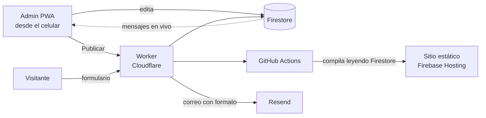

# Daniel Osorio Maturana

**Software Engineer · Medellín, Colombia**

### Del silicio a la IA.

Arquitectura, integraciones e IA aplicada.

[Portafolio](https://daniel-dev-portafolio.web.app) · [LinkedIn](https://www.linkedin.com/in/dom-tyler-dev) · [daniel-dev-osoma@gmail.com](mailto:daniel-dev-osoma@gmail.com) · [GitHub](https://github.com/dom-tyler)

---

## Quién soy

Diseño y construyo sistemas de software, desde la arquitectura hasta el producto en manos de usuarios. Mi base empezó abajo, en algoritmos y electrónica digital con prototipos en Arduino. Hoy trabajo arriba: servicios, integraciones de pagos y mensajería, e IA aplicada con agentes y RAG.

Estudio Ingeniería Informática en el Politécnico Jaime Isaza Cadavid. He trabajado en equipos de producto (ZETA, DevsCode) y en el semillero LaboratorioZ.

Este repositorio es mi portafolio y, a la vez, una muestra de cómo trabajo.

## Cómo trabajo

> Entiendo el problema, trazo los límites y elijo la arquitectura más simple que aguante lo que viene.

| 01 Descubrir | 02 Modelar | 03 Decidir | 04 Construir | 05 Operar |
|---|---|---|---|---|
| Usuarios, riesgos, criterios de éxito | Dominios, contratos y datos | Arquitectura con costos explícitos | Tipado, probado, en CI | Deploy, métricas e iteración |
| `brief.md` | `openapi.yaml` | `ADR-001` | `ci ✓ passing` | `p95 · logs` |

## Proyectos destacados

| Proyecto | Qué resuelve | Estado |
|---|---|---|
| [Excentrix](https://daniel-dev-portafolio.web.app/proyectos/excentrix) | Catálogo de perfumería con decants y compra guiada por WhatsApp | En vivo · [sitio](https://excentrix.web.app/) |
| [Dayed Inmobiliaria](https://daniel-dev-portafolio.web.app/proyectos/dayed-inmobiliaria) | Descubrimiento de inmuebles con filtros, mapa, favoritos y contacto directo | Caso privado |
| [LiquiLegal](https://daniel-dev-portafolio.web.app/proyectos/liquilegal) | Pasarela de pagos y recuperación documental con un microservicio RAG | Caso privado |
| [EasyLang Compiler](https://daniel-dev-portafolio.web.app/proyectos/easylang) | Lenguaje educativo con intérprete propio, interfaz gráfica y CLI | Académico · [repo](https://github.com/dom-tyler/EasyLang-Compiler) |

En el laboratorio también hay CRM multicanal con agente conversacional, multitenancy en NestJS + Prisma, una app social full stack y sistemas de juego en Godot 4. Todos están en el [portafolio](https://daniel-dev-portafolio.web.app/proyectos).

## Stack por capa

| Capa | Herramientas |
|---|---|
| Fundamentos | C · C++ · Java · Python · TypeScript · SQL |
| Interfaz | React · Next.js · Astro · Vite · Tailwind · Three.js |
| Servicios | Node.js · NestJS · Express · FastAPI · Spring Boot |
| Datos | PostgreSQL · MongoDB · Firestore · Prisma · Supabase |
| IA | LangChain · LangGraph · RAG · Embeddings · MCP |
| Agentes de código | Claude Code · Codex · Kimi · modelos locales en LM Studio |
| Integraciones | Meta / WhatsApp · Bold · Firebase Auth · n8n |
| Infraestructura | Firebase · Vercel · GitHub Actions · Docker · Linux |
| Hardware | Arduino · electrónica digital · Proteus |

## Cómo está hecho este portafolio

No es una plantilla. Es un sistema pequeño con sus propias decisiones de arquitectura:

- **Hero en WebGL en tiempo real:** un chip QFP procedural que arranca con el onboarding, late, reacciona al cursor y una mano robótica lo toma y lo presenta. Todo con three.js por import dinámico, con niveles de calidad según los FPS medidos y un póster SVG como respaldo.
- **Estático primero:** HTML generado en el build, para que sea rápido y lo indexen bien los buscadores. El 3D llega como mejora progresiva y respeta `prefers-reduced-motion`.
- **Contenido gestionado:** edito proyectos, tecnologías y cómo se integra cada una desde un admin instalable en el teléfono. Un botón **Publicar** reconstruye el sitio, así nada a medio editar llega al público.
- **Contacto sin exponer mi correo:** el formulario pasa por validación, honeypot, Turnstile y límite por IP. Me llega un correo con formato y el mensaje queda en la bandeja del admin.
- **Un solo contrato de datos:** el mismo esquema Zod valida el sitio, el admin y las funciones.

Stack del repo: Astro · TypeScript · Tailwind 4 · three.js · Firebase (Hosting, Firestore, Auth) · Cloudflare Workers · Resend · pnpm workspaces. Todo en planes gratuitos.

## Contacto

Estoy disponible para proyectos y equipos de producto.
- [LinkedIn](https://www.linkedin.com/in/dom-tyler-dev)
- [daniel-dev-osoma@gmail.com](mailto:daniel-dev-osoma@gmail.com)
- [El formulario del portafolio](https://daniel-dev-portafolio.web.app/#contacto)

---

Guía técnica para correr y desplegar el repo: [docs/DEVELOPMENT.md](docs/DEVELOPMENT.md).
