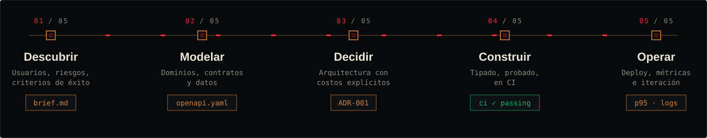
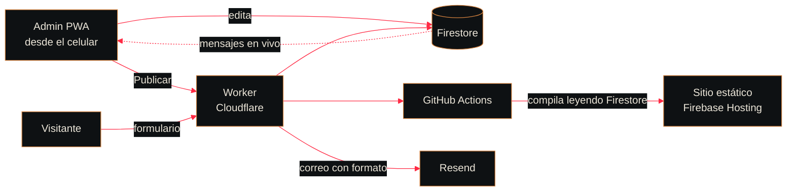

 

<b>MEDELLÍN, COLOMBIA</b> &nbsp;·&nbsp; DISPONIBLE PARA PROYECTOS Y EQUIPOS DE PRODUCTO

 

## Quién soy

<table>
<tr>
<td width="62%" valign="top">

Diseño y construyo **sistemas de software**, desde la arquitectura hasta el producto en manos de usuarios.

Mi base empezó abajo, en **algoritmos y electrónica digital** con prototipos en Arduino. Hoy trabajo arriba: servicios, **integraciones de pagos y mensajería**, e **IA aplicada** con agentes y RAG.

Estudio Ingeniería Informática en el Politécnico Jaime Isaza Cadavid. He trabajado en equipos de producto (ZETA, DevsCode) y en el semillero LaboratorioZ.

Este repositorio es mi portafolio y, a la vez, una muestra de cómo trabajo.

</td>
<td width="38%" valign="top">

**Enfoque**

- Arquitectura de software
- APIs e integraciones
- IA aplicada: agentes, RAG
- Producto de punta a punta

**Ahora**

- Pagos y mensajería en producción
- Agentes de código en el flujo diario

</td>
</tr>
</table>

## Cómo trabajo

> **Entiendo el problema, trazo los límites y elijo la arquitectura más simple que aguante lo que viene.**

## Proyectos

Los casos y el stack por capa viven en el portafolio y se actualizan desde el admin, así que siempre están al día.

## Cómo está hecho este portafolio

No es una plantilla. Es un sistema pequeño, con sus propias decisiones de arquitectura y todo en planes gratuitos.

| Pieza | Decisión |
|:--|:--|
| **Hero WebGL** | Chip QFP procedural con onboarding, latido y reacción al cursor. Una mano robótica lo toma y lo presenta. three.js entra por import dinámico, hay niveles de calidad según los FPS medidos y un póster SVG como respaldo. |
| **Estático primero** | HTML generado en el build, rápido e indexable. El 3D es una mejora progresiva y respeta `prefers-reduced-motion`. |
| **Contenido gestionado** | Proyectos, tecnologías y cómo se integra cada una se editan desde un admin instalable en el teléfono. **Publicar** reconstruye el sitio: nada a medio editar llega al público. |
| **Contacto privado** | Validación, honeypot, Turnstile y límite por IP. Llega un correo con formato y el mensaje queda en la bandeja del admin, sin exponer mi correo de trabajo. |
| **Un solo contrato** | El mismo esquema Zod valida el sitio, el admin y la API. |

## Contacto

**¿Tienes un sistema por construir?** Hablemos.

 

Hecho en Medellín · Guía técnica para correr y desplegar el repo: <a href="docs/DEVELOPMENT.md">docs/DEVELOPMENT.md</a>

